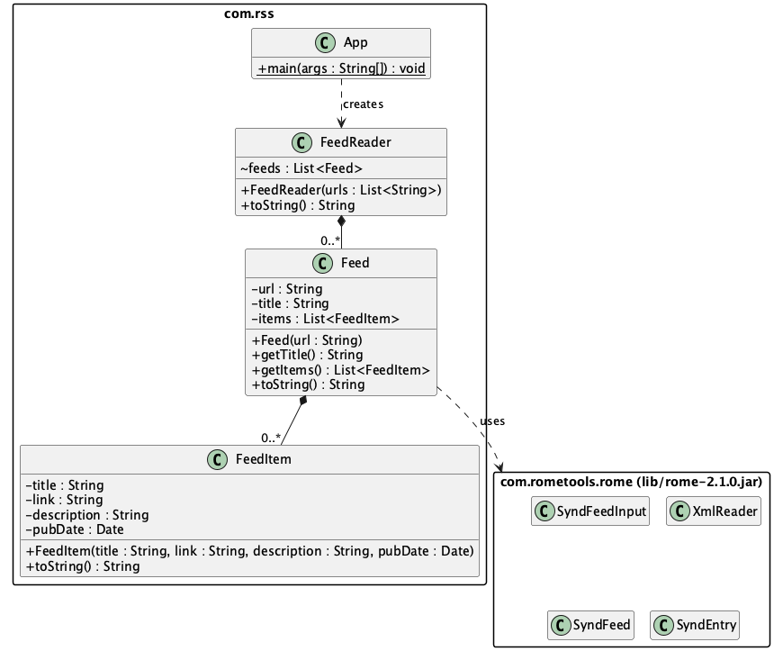

# Building a Command-Line RSS Reader in Java

In this tutorial you will build a small command-line app that:

1. reads a list of RSS feed URLs from a text file, and
2. downloads each feed and prints its articles.

You will use the **Rome** library to download and parse the feeds. You will **not** use Maven. Instead you will download the library's JAR files yourself and add them to a plain VS Code Java project. This shows you what a build tool such as Maven does for you behind the scenes.



### What you will practise

- Classes, objects, fields and constructors
- Packages
- Lists (`List`, `ArrayList`) and loops
- Reading a file
- Exception handling (`try`/`catch`)
- Using an external library from JAR files

---

## Step 0: What you need

- **A JDK, version 11 or later.** Check by running this in a terminal:
  ```bash
  java -version
  ```
- **VS Code** with the **Extension Pack for Java** (by Microsoft) installed. Open the Extensions panel (`Ctrl+Shift+X` / `Cmd+Shift+X`), search for _Extension Pack for Java_, and install it.
- An internet connection, because the app downloads live feeds.

---

## Step 1: Create a project without a build tool

1. In VS Code, open the Command Palette (`Ctrl+Shift+P` / `Cmd+Shift+P`).
2. Run **Java: Create Java Project**.
3. Choose **No build tools**.
4. Pick a folder to create it in, and name the project `rss-aggregator`.

VS Code creates this layout:

```
rss-aggregator/
├── .vscode/
│   └── settings.json
├── lib/            ← you will put the library JARs here
└── src/
    └── App.java    ← delete this; you will write your own
README.md
```

Open `.vscode/settings.json`. It should contain:

```json
{
  "java.project.sourcePaths": ["src"],
  "java.project.outputPath": "bin",
  "java.project.referencedLibraries": ["lib/**/*.jar"]
}
```

The `referencedLibraries` line is the important one. It tells VS Code to put **every `.jar` file in `lib/` on the classpath**. Copy a JAR into `lib/` and your code can use it. (If you created the folder by hand, create this file yourself with the content above.)

Delete the generated `src/App.java`.

---

## Step 2: Download Rome and its dependencies

Rome is published on Maven Central. You can download the main JAR here:

> https://repo1.maven.org/maven2/com/rometools/rome/2.1.0/

Click **`rome-2.1.0.jar`** to download it. Do not use the `-sources` or `-javadoc` JARs. They hold source code and documentation, not compiled classes.

### Rome needs other libraries too

Rome uses other libraries, which are its **dependencies**. You can see them in the `rome-2.1.0.pom` file in the same folder. Maven would download them for you automatically. Without Maven, you download them yourself. Rome 2.1.0 needs:

| Library                | Why Rome needs it                        | Download page (click the `.jar` that is **not** `-sources`/`-javadoc`) |
| ---------------------- | ---------------------------------------- | ---------------------------------------------------------------------- |
| `rome-2.1.0.jar`       | The library itself                       | https://repo1.maven.org/maven2/com/rometools/rome/2.1.0/               |
| `rome-utils-2.1.0.jar` | Helper classes used by Rome              | https://repo1.maven.org/maven2/com/rometools/rome-utils/2.1.0/         |
| `jdom2-2.0.6.1.jar`    | Parses the XML that feeds are written in | https://repo1.maven.org/maven2/org/jdom/jdom2/2.0.6.1/                 |
| `slf4j-api-2.0.6.jar`  | Logging interface that Rome writes to    | https://repo1.maven.org/maven2/org/slf4j/slf4j-api/2.0.6/              |

Move all the downloaded JARs into your project's `lib/` folder:

```
lib/
├── jdom2-2.0.6.1.jar
├── rome-2.1.0.jar
├── rome-utils-2.1.0.jar
└── slf4j-api-2.0.6.jar
```

> **What if I skip one?** Your code may still compile. Then it crashes at runtime with a `NoClassDefFoundError` naming a missing class, for example `org/jdom2/...`. That error tells you a JAR is missing from `lib/`.
>
> **What is the `SLF4J: No SLF4J providers were found` warning?** SLF4J is only a logging _interface_. With no logging implementation in `lib/`, it warns once and then discards Rome's log messages. The warning is harmless, so you can ignore it.

**Check:** In the VS Code Explorer, expand **Java Projects → rss-aggregator → Referenced Libraries**. All the JARs should be listed. If they are not, run **Java: Clean Java Language Server Workspace** from the Command Palette.

### Shortcut: download them all in one zip

If you'd rather skip the individual downloads, download [`rome-2.1.0-with-dependencies.zip`](./lib/rome-2.1.0-with-dependencies.zip), which contains all four JARs. Extract it into your project's `lib/` folder so that the `.jar` files sit directly inside `lib/`, not in a subfolder.

### Alternative: download from the terminal

On macOS, Linux, or Git Bash on Windows, run this from inside the project folder:

```bash
cd lib
curl -O https://repo1.maven.org/maven2/com/rometools/rome/2.1.0/rome-2.1.0.jar
curl -O https://repo1.maven.org/maven2/com/rometools/rome-utils/2.1.0/rome-utils-2.1.0.jar
curl -O https://repo1.maven.org/maven2/org/jdom/jdom2/2.0.6.1/jdom2-2.0.6.1.jar
curl -O https://repo1.maven.org/maven2/org/slf4j/slf4j-api/2.0.6/slf4j-api-2.0.6.jar
cd ..
```

---

## Step 3: Create the package and the data files

Java classes are organised into **packages**. A package name maps onto folders, so the package `com.rss` lives in `src/com/rss/`.

Right click `src/` in the Explorer, and choose **New Java Package**. Name it `com.rss`. This will create the folder `src/com/rss/`.

Every class in this tutorial goes in there, and each file starts with:

```java
package com.rss;
```

Next, create a file called `feeds.txt` in the **project root**, next to `src/` and `lib/`, not inside `src/`. Put one feed URL on each line:

```
https://news.ycombinator.com/rss
https://feeds.bbci.co.uk/news/rss.xml
```

The finished project looks like this:

```
rss-aggregator/
├── feeds.txt
├── lib/        (the JARs)
└── src/com/rss/
    ├── App.java
    ├── Feed.java
    ├── FeedItem.java
    └── FeedReader.java
```

---

## Step 4: `FeedItem`, a single article

Start with the simplest class. A `FeedItem` holds the data for one article and defines how that article is displayed. At this stage, you may want to try and create the class by looking at the UML diagram above. If you get stuck, the code is below.

Create `src/com/rss/FeedItem.java`:

```java
package com.rss;

import java.util.Date;

public class FeedItem {

	private String title;
	private String link;
	private String description;
	private Date pubDate;

	public FeedItem(String title, String link, String description, Date pubDate) {
		this.title = title;
		this.link = link;
		this.description = description;
		this.pubDate = pubDate;
	}

	@Override
	public String toString() {
		return "Title: " + title + "\n"
				+ "Link: " + link + "\n"
				+ "Description: " + description + "\n"
				+ "Published Date: " + pubDate;
	}
}
```

**Things to notice**

- The fields are `private`, so other classes cannot access them directly. The class does not need getters or setters: `toString()` provides the formatted article text used when displaying an item.
- `this.title = title;` copies the constructor's parameter into the object's field. `this` means "this object".
- `toString()` controls what you see when you print an object with `System.out.println(item)`.

---

To test this works, create a file `src/com/rss/App.java`:

```java
package com.rss;

import java.util.Date;

public class App {
	public static void main(String[] args) {
		FeedItem item = new FeedItem("Title", "Link", "Description", new Date());
		System.out.println(item);
	}
}
```

## Step 5: `Feed`, one RSS feed, built with Rome

A `Feed` takes a URL. It uses Rome to download and parse the feed, then turns each entry into a `FeedItem`.

Create `src/com/rss/Feed.java`:

```java
package com.rss;

import java.io.InputStream;
import java.net.URI;
import java.net.URL;
import java.util.ArrayList;
import java.util.List;

import com.rometools.rome.feed.synd.SyndEntry;
import com.rometools.rome.feed.synd.SyndFeed;
import com.rometools.rome.io.SyndFeedInput;
import com.rometools.rome.io.XmlReader;

public class Feed {

	private String url;
	private String title = "";
	private List<FeedItem> items = new ArrayList<>();

	public Feed(String url) {
		this.url = url;
		try {
			URL feedUrl = URI.create(url).toURL();
			InputStream stream = feedUrl.openStream();
			SyndFeed feed = new SyndFeedInput().build(new XmlReader(stream));
			stream.close();
			this.title = feed.getTitle();
			for (SyndEntry entry : feed.getEntries()) {
				// Some feeds leave out the description, so guard against null
				String description = "";
				if (entry.getDescription() != null) {
					description = entry.getDescription().getValue();
				}
				FeedItem item = new FeedItem(entry.getTitle(), entry.getLink(),
						description, entry.getPublishedDate());
				this.items.add(item);
			}
		} catch (Exception e) {
			System.err.println("Could not read feed " + url + ": " + e.getMessage());
		}
	}

	public String getTitle() {
		return title;
	}

	public List<FeedItem> getItems() {
		return items;
	}

	@Override
	public String toString() {

		String feeds = "============= " + title + " =============\n";

		for (FeedItem item : items) {
			feeds += item.toString() + "\n";
			feeds += "--------------------------------------------------\n";
		}

		return feeds;

	}
}
```

**How the Rome part works**

This takes a little getting used to. [It's worth reading the Rome documentation](https://rometools.github.io/rome/HowRomeWorks/RomeV0.4TutorialUsingRomeToReadASyndicationFeed.html) to understand the classes and methods. Here's a breakdown of the key lines:

1. `URI.create(url).toURL()` turns the text into a `URL` object. (`new URL(String)` is deprecated in recent Java versions.)
2. `feedUrl.openStream()` connects to the web server and gives you the raw bytes of the feed.
3. `XmlReader` turns those bytes into text and works out the character encoding.
4. `SyndFeedInput().build(...)` parses the XML into a `SyndFeed`. The "Synd" stands for _syndication_. A `SyndFeed` looks the same whether the feed was RSS 1.0, RSS 2.0 or Atom, so your code does not need to care which format it was.
5. `feed.getEntries()` returns a list of `SyndEntry` objects, one per article. You copy the parts you need into your own `FeedItem`.

**Why not just call `new XmlReader(url)`?** That constructor still exists in Rome 2.x but is deprecated, so VS Code would show a warning.

**Why the `try`/`catch`?** Many things can go wrong: no internet, a mistyped URL, or a server returning something that is not a feed. Catching the exception means one broken feed prints an error and the others still load.

**Why check `getDescription()` for `null`?** Some feeds leave the description out. Calling `.getValue()` on `null` would throw a `NullPointerException`.

> **Checkpoint:** If VS Code underlines the `com.rometools...` imports in red, the JARs are not on the classpath. Go back to Step 2.

---

## Step 6: `FeedReader`, all the feeds together

`FeedReader` takes the full list of URLs, builds a `Feed` for each one, and turns all of them into text with `toString()`.

Create `src/com/rss/FeedReader.java`:

```java
package com.rss;

import java.util.ArrayList;
import java.util.List;

public class FeedReader {

	List<Feed> feeds = new ArrayList<>();

	public FeedReader(List<String> urls) {
		for (String url : urls) {
			feeds.add(new Feed(url));
		}
	}

	@Override
	public String toString() {
		String result = "";
		for (Feed feed : feeds) {
			result += feed.toString() + "\n";
		}
		return result;
	}
}
```

**Things to notice**

- `FeedReader`'s `toString()` calls `toString()` on each `Feed`, which in turn calls `toString()` on each `FeedItem`. Each class is responsible for displaying its own data, so `FeedReader` needs only one loop.

---

## Step 7: `App`, putting it together

`App` holds the `main` method, which is the entry point of the program. It reads the feed URLs from `feeds.txt`, gives them to a `FeedReader`, and prints every article.

Replace the test code in `src/com/rss/App.java` with:

```java
package com.rss;

import java.io.BufferedReader;
import java.io.FileReader;
import java.io.IOException;
import java.util.ArrayList;
import java.util.List;

public class App {

	public static void main(String[] args) {
		List<String> urls = new ArrayList<>();
		try {
			BufferedReader br = new BufferedReader(new FileReader("feeds.txt"));
			String line;
			while ((line = br.readLine()) != null) {
				urls.add(line);
			}
			br.close();
		} catch (Exception e) {
			System.err.println("Failed to read feeds.txt: " + e.getMessage());
		}

		FeedReader feedReader = new FeedReader(urls);
		System.out.println(feedReader);
	}
}
```

**Things to notice**

- The `try`/`catch` handles an `IOException`, for example when `feeds.txt` does not exist. Without it, the code would not compile, because Java makes you deal with this kind of exception.
- `br.close()` closes the file once you have finished reading it.
- `while ((line = br.readLine()) != null)` reads one line at a time until the end of the file, where `readLine()` returns `null`.
- Each class does one job: `App` reads the list of URLs, `FeedReader` manages all the feeds, `Feed` downloads one feed, and `FeedItem` holds one article.

---

## Step 8: Run it

### From VS Code

Open `App.java` and click **Run** above the `main` method, or press `F5`.

The program reads `feeds.txt` from the **working directory**. When VS Code runs a project, the working directory is the folder you opened, so `feeds.txt` must be in the project root. If you see `Failed to read feeds.txt`, the file is in the wrong place.

### From the terminal (optional)

This is what VS Code does for you. Run these commands from the project root:

```bash
# Compile: -cp puts the JARs on the classpath, -d puts .class files in bin/
javac -d bin -cp "lib/*" src/com/rss/*.java

# Run: the classpath now needs your classes (bin) AND the JARs
java -cp "bin:lib/*" com.rss.App
```

On **Windows**, the classpath separator is `;` instead of `:`:

```powershell
java -cp "bin;lib/*" com.rss.App
```

### Try it

You should see output like this:

```
============= Hacker News =============
Title: ...
Link: https://...
Description: ...
Published Date: ...
--------------------------------------------------
...
============= BBC News =============
Title: ...
```

Also try adding a line such as `not a url` or `https://example.com/missing.xml` to `feeds.txt`. The `try`/`catch` in `Feed` should print an error for that line, and the other feeds should still load.

---

## Troubleshooting

| Problem                                                            | Cause and fix                                                                                |
| ------------------------------------------------------------------ | -------------------------------------------------------------------------------------------- |
| `package com.rometools.rome... does not exist`                     | The JARs are not in `lib/`, or `settings.json` is missing `referencedLibraries`. See Step 2. |
| `NoClassDefFoundError: org/jdom2/...` or `org/slf4j/...`           | A dependency JAR is missing from `lib/`. Download it.                                        |
| `SLF4J: No SLF4J providers were found`                             | This is expected and harmless. See the note in Step 2.                                       |
| `Failed to read feeds.txt`                                         | `feeds.txt` is not in the project root.                                                      |
| `Could not read feed ...: Server returned HTTP response code: 403` | That website blocks simple programs from downloading its feed. Try a different feed.         |
| The red underlines stay after adding the JARs                      | Run **Java: Clean Java Language Server Workspace** from the Command Palette.                 |

---

## Exercises

1. **Encapsulation.** Make the fields in `FeedItem` `final` and see what happens if you try to change one after construction.
2. **Tidy the description.** Many descriptions contain HTML, such as `<a href=...>`. Use `replaceAll("<[^>]*>", "")` to remove the tags, and cut descriptions down to 200 characters.
3. **Sort by date.** Print all the articles from every feed, newest first. Look up `List.sort` and `Comparator`. Watch out for articles whose `pubDate` is `null`.
4. **Add a menu.** Use a `Scanner` and a `while` loop to show a menu with options such as _Fetch feeds_ and _Exit_.
5. **Save favourites.** Number the articles when you print them, then add a menu option that asks for an article number and appends that article to `saved_items.txt`. Hint: `new FileWriter(filename, true)` opens a file in append mode. What should happen if the user types `abc` or `9999`?
6. **Reflection.** Compare this project with a Maven `pom.xml` that lists Rome as a single dependency. What did you have to do by hand that Maven would have done for you?
